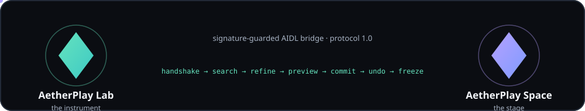
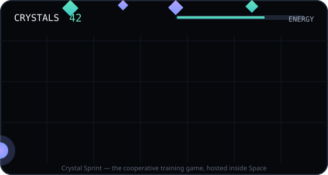

<div align="center">




[](https://github.com/siddhant-pardeshi/aetherplay-suite/releases)
[](docs/COMPATIBILITY.md)
[](build.gradle.kts)
[](gradle/libs.versions.toml)
[](docs/ARCHITECTURE.md)
[](LICENSE)
[](https://github.com/siddhant-pardeshi/aetherplay-suite/actions/workflows/ci.yml)

**Two apps. One instrument. A stage for local game experimentation.**

**AetherPlay Lab** searches a live game session, refines results down to one address, previews every change before it lands, journals each write, and undoes or freezes it. **AetherPlay Space** hosts the session, the training game, and your named spaces with separate save data — and pairs with Lab over a signature-guarded bridge.

[Hosted interactive tour](https://siddhant-pardeshi.github.io/aetherplay-suite/) · [Full walkthrough video](https://github.com/siddhant-pardeshi/aetherplay-suite/releases/tag/v0.1.0) · [Step-by-step video (0.1.1)](https://github.com/siddhant-pardeshi/aetherplay-suite/releases/tag/v0.1.1) · [Quickstart](docs/QUICKSTART.md) · [First-session tutorial](docs/TUTORIAL_01_FIRST_SESSION.md)

</div>


## ✦ The pair

<table>
<tr>
<td width="50%" valign="top">

### <picture></picture> AetherPlay Lab — the instrument

Search, refine, inspect, edit — safely.

- Exact, range & unknown-value search
- 10 value types — I8→U64, F32/F64, little-endian
- Refine: changed / unchanged / increased / decreased / exact
- **Previewed writes** — see old → new before anything changes
- Change journal with identity-checked **undo**
- Bounded **freezes** that always stop with the session
- Saved experiments, shareable as JSON
- Dark, OLED & light themes · reduce-motion switch

</td>
<td width="50%" valign="top">

### <picture></picture> AetherPlay Space — the stage

Host sessions and keep saves apart.

- Named spaces with **separate save data**
- One-tap session start, honest status, stop control
- Foreground session notification with **Open game / Stop**
- Hosts **Crystal Sprint**, the cooperative training game
- Signature-guarded bridge to Lab — protocol 1.0
- Storage usage, per-space management
- No account, no network, nothing leaves the phone

</td>
</tr>
</table>

<div align="center">

</div>

<table>
<tr>
<td width="50%"></td>
<td width="50%"></td>
</tr>
</table>


## ✦ How an experiment feels

1. **Start a session in Space** — a visible action, a live notification, a running game.
2. **Open Crystal Sprint**, catch a few crystals. The counter on screen is the value you'll hunt.
3. **Search** `Int32 · exact · 5` in Lab — mirrors and decoys are found too, on purpose.
4. **Play a moment. Refine — increased. Refine — exact 6.** The set collapses to one address.
5. **Preview a write of 99 → commit.** The HUD flips to 99. It's journaled.
6. **Undo it.** The old value returns — because the current value is still yours.
7. **Freeze it, watch it hold, then stop the session.** Every freeze stops. Guaranteed.


## ✦ Honest capability matrix

| Capability | Status | Where |
|---|:---:|---|
| Search · refine · read · preview · write · undo · freeze |  | Lab ↔ Crystal Sprint session |
| Named spaces with separate saves |  | Space |
| Signature-guarded paired bridge (AIDL, protocol 1.0) |  | Lab + Space |
| Hosted interactive tour (labeled simulations) |  | [demo-web](docs/index.html) |
| Guest runtime for third-party games |  | Not in this build — [why](docs/KNOWN_LIMITATIONS.md) |
| Pattern / pointer search, scripts, floating overlay |  | Roadmap |
| Anti-cheat evasion / online-game tampering |  | Never — [ethos](#-scope-and-ethos) |

Everything marked **shipping** works end-to-end against the included cooperative training game in this repository, and is exercised by unit tests where it is pure logic ([model](core/model), [search engine](engine/search)). Nothing has been tested on a physical device yet — see [STATUS](docs/STATUS.md).

## ✦ Build it

```bash
git clone https://github.com/siddhant-pardeshi/aetherplay-suite.git
cd aetherplay-suite
./gradlew :apps:lab:assembleDebug :apps:space:assembleDebug
adb install -r apps/space/build/outputs/apk/debug/space-debug.apk
adb install -r apps/lab/build/outputs/apk/debug/lab-debug.apk
```

Requires JDK 17 and an Android SDK with `platforms;android-37.0`. Paired **debug** builds share the debug keystore, so the signature-guarded bridge works out of the box — install both APKs from the same machine. Full guide: [docs/QUICKSTART.md](docs/QUICKSTART.md).

Or grab the paired APKs from [Releases](https://github.com/siddhant-pardeshi/aetherplay-suite/releases) — every asset ships with SHA-256 checksums.

## ✦ Architecture at a glance

```
aetherplay-suite
├── apps/lab          # the instrument — Compose UI, bridge client
├── apps/space        # the stage — session service, Crystal Sprint, spaces
├── core/model        # value types, codec, protocol negotiation (pure Kotlin)
├── core/protocol     # AIDL contract + wire parcelables (signature-guarded)
├── core/design       # Aurora Precision design system (tokens, motion, components)
├── engine/search     # streaming search & refinement engine (pure Kotlin)
├── demo-web          # hosted interactive tour (clearly-labeled simulations)
├── docs/             # guides, tutorials, compatibility, honest status
└── scripts/          # asset generation (icons), reproducible builds
```

- **Sessions always start from a visible action in Space** (foreground-service rules, honest notification, real stop button).
- Every broker call is **caller-checked** (signature permission), **generation-checked** (stale handles are rejected with an actionable message), and bounded (read-only playfield, fixed writable field set, 100k result cap, paged reads).
- The search engine is a pure-JVM component verified against fixtures; the cooperative memory surface is deliberately small, readable, and full of decoys so the *workflow* is the lesson.
- Deep dive: [docs/ARCHITECTURE.md](docs/ARCHITECTURE.md)

## ✦ Scope and ethos

AetherPlay is a local experimentation and education tool for games you own or have permission to test. It does not target online, competitive, or server-authoritative games — not as a limitation to work around, but as a permanent design boundary. No anti-cheat evasion, no DRM bypass, no other players' sessions, ever.

The third-party guest runtime is the suite's open research question. Building an honest container on modern Android is hard, and this project will not ship a shortcut launcher or a work-profile clone dressed up as virtualization. Until the real thing passes its feasibility gate, that cell stays yellow — [read the full limitations](docs/KNOWN_LIMITATIONS.md).

## ✦ Documentation

| Guide | What's inside |
|---|---|
| [Quickstart](docs/QUICKSTART.md) | Build, install the pair, first five minutes |
| [User guide](docs/USER_GUIDE.md) | Every screen in both apps |
| [Tutorial 1 — First session](docs/TUTORIAL_01_FIRST_SESSION.md) | Search → refine → write → undo → freeze, step by step |
| [Tutorial 2 — Search & refine](docs/TUTORIAL_02_SEARCH_REFINE_AND_UNDO.md) | Unknown-value workflows, undo semantics |
| [Tutorial 3 — Spaces & saves](docs/TUTORIAL_03_SPACES_AND_SAVE_DATA.md) | Named spaces, persistence, deletion |
| [iQOO Neo 6 setup](docs/IQOO_NEO6_SETUP.md) | Funtouch OS notes (physical validation pending) |
| [Troubleshooting](docs/TROUBLESHOOTING.md) | Connection, mismatch, stale, freezes, notifications |
| [Compatibility](docs/COMPATIBILITY.md) | Honest per-capability matrix (+ machine-readable) |
| [Performance](docs/PERFORMANCE.md) | Budgets as targets; measurement recipes; no fabricated numbers |
| [Architecture](docs/ARCHITECTURE.md) | Modules, binder flow, state machines, security model |
| [Privacy](docs/PRIVACY.md) | Fully local; no INTERNET permission, no analytics |
| [Release & signing](docs/RELEASE_AND_SIGNING.md) | Paired signing, checksums, GitHub Releases |
| [Known limitations](docs/KNOWN_LIMITATIONS.md) | The complete honest list |
| [Status](docs/STATUS.md) | Milestone-by-milestone truth |

## ✦ Roadmap

| Milestone | State | Notes |
|---|:---:|---|
| M0 — Feasibility & recon |  | Third-party runtime candidates documented; spike still open |
| M1 — Paired foundation |  | Both APKs build; authenticated versioned bridge; design system |
| M2 — Lab vertical slice |  | Search/refine/read/preview/edit/undo/freeze vs training game |
| M3 — Space guest runtime |  | The central unresolved item |
| M4 — Polish & reliability |  | Theming, persistence, dialogs done; OEM cases pending |
| M5 — Device verification |  | No physical device tested yet, incl. iQOO Neo 6 |
| M6 — Delivery |  | Repo, CI, docs, tour shipped; on-device demo pending |

## ✦ Credits

- Design language **Aurora Precision**, icons, and the Crystal Sprint game are original works for this project (`scripts/generate_icons.py`).
- Built with [Kotlin](https://kotlinlang.org), [Jetpack Compose](https://developer.android.com/jetpack/compose) and `kotlinx-coroutines` (Apache-2.0). Full notices: [THIRD_PARTY_NOTICES.md](THIRD_PARTY_NOTICES.md).
- No code, assets, or branding from any reference tool were used; the reference APK in the original brief was only ever statically inspected and never redistributed.

<div align="center">


**MIT © 2026 Siddhant Pardeshi** · made with patience, taste, and an allergy to fake buttons

</div>
